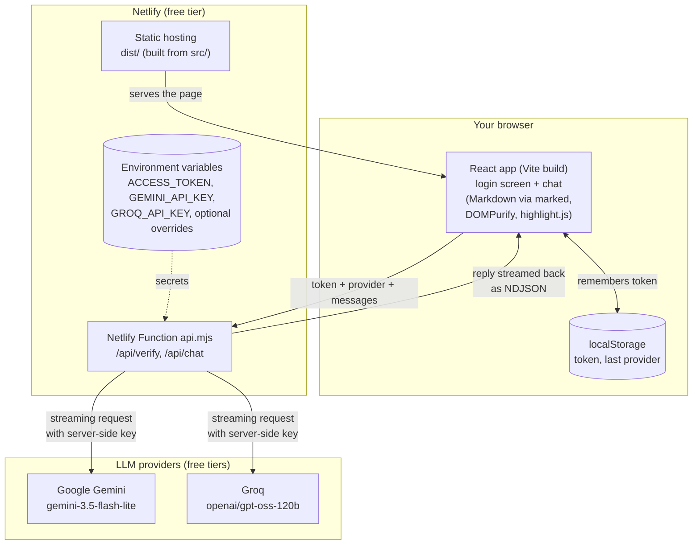
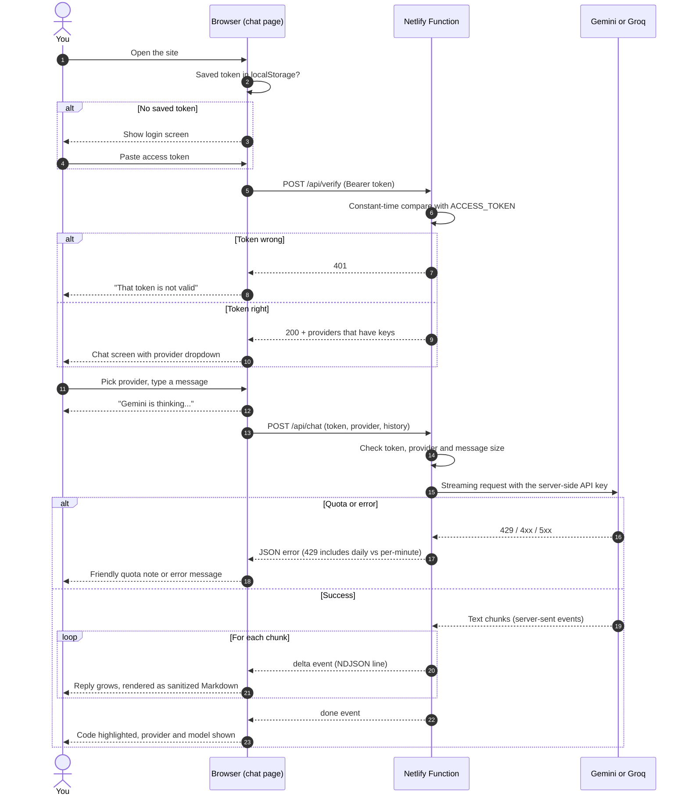

# LLMate

A private LLM chat hosted on Netlify. Only someone holding the access token can use it.

- **Frontend:** a small React app (`src/`, built with Vite and Tailwind CSS) with a token-only login screen and a chat view. A few [Magic UI](https://magicui.design) components (in `src/components/ui/`) add restrained motion: the dot grid and spotlight card on the login screen, messages fading in, a shimmer on the "thinking" note, and a light beam around the message box while a reply streams. Fonts and libraries are bundled and self-hosted; the page loads nothing from other sites.
- **Backend:** one Netlify Function (`netlify/functions/api.mjs`) serving `/api/verify` and `/api/chat`. It checks the token with a constant-time compare, then calls the provider you picked for that chat: **Google Gemini** (free tier, Flash-Lite model) or **Groq** (free tier). There is no automatic fallback.
- **Secrets** (the token and both API keys) live only in Netlify environment variables. The browser never sees the provider keys.

Everything here runs on free tiers: Netlify Starter, Gemini API free tier and Groq free tier.

## Deploy

### 1. Get the free API keys

**Gemini**
1. Go to [Google AI Studio](https://aistudio.google.com/apikey) and sign in with a Google account.
2. Click **Create API key**. No billing account is needed for the free tier.
3. Copy the key. This is `GEMINI_API_KEY`.

> Note: on the free tier Google may use your prompts to improve its products. Don't send anything you wouldn't want reviewed. Groq does not train on API data.

**Groq**
1. Go to the [Groq console](https://console.groq.com/keys) and sign up.
2. Click **Create API Key** and copy it. This is `GROQ_API_KEY`.

You can deploy with only one of the two keys; the provider picker only lists providers whose key is set.

### 2. Generate your access token

Any long random string works. Pick one of:

```sh
npm run token                       # from this repo, needs Node 20.19+
openssl rand -base64 32             # macOS / Linux
node -e "console.log(require('crypto').randomBytes(32).toString('base64url'))"
```

Keep it in your password manager. The server refuses tokens shorter than 16 characters; use at least 32.

### 3. Create the Netlify site

1. In [Netlify](https://app.netlify.com), click **Add new site → Import an existing project** and pick this GitHub repo.
2. Leave the build settings empty in the Netlify UI. Netlify reads `netlify.toml`: build command `npm run build`, publish dir `dist`, functions dir `netlify/functions`, Node 22. (If you typed a build command or publish directory into the UI earlier, clear them: UI values override the file.)
3. Before (or right after) the first deploy, open **Site configuration → Environment variables** and add:

| Variable | Required | Value |
|---|---|---|
| `ACCESS_TOKEN` | yes | the token from step 2 |
| `GEMINI_API_KEY` | one of the two | key from Google AI Studio |
| `GROQ_API_KEY` | one of the two | key from the Groq console |
| `GEMINI_MODEL` | no | defaults to `gemini-3.5-flash-lite` |
| `GROQ_MODEL` | no | defaults to `openai/gpt-oss-120b` |
| `SYSTEM_PROMPT` | no | instructions sent with every chat |

   Mark `ACCESS_TOKEN` and the keys as **secret** values if your plan offers it, and scope them to **Functions**.
4. **Deploys → Trigger deploy → Deploy site** so the function picks up the variables. Any later change to a variable also needs a redeploy.
5. Open the site, paste your token, and chat.

If a default model is retired, set `GEMINI_MODEL` or `GROQ_MODEL` to a current one from the [Gemini models list](https://ai.google.dev/gemini-api/docs/models) or [Groq models list](https://console.groq.com/docs/models) and redeploy.

### Rotating the token

Change `ACCESS_TOKEN` in Netlify and redeploy. Any browser holding the old token is logged out on its next request.

## How it works

### The pieces



The browser only ever talks to your own Netlify site. The provider API keys live in Netlify environment variables and are used only inside the function, so they never reach the browser.

### The user flow



### Who can see your chats

Of the pieces in the diagrams, four handle what you type. **Your browser** holds the conversation only in the open tab. It is not saved, and a reload or **New chat** clears it. `localStorage` keeps only your access token and the last provider you picked. **Netlify** runs the function, so each message passes through Netlify's servers (encrypted in transit with HTTPS). The function doesn't store chats or log prompts or replies. It logs only an error reason when a provider call fails, and Netlify keeps function logs for up to 7 days, depending on your plan ([Netlify logs](https://docs.netlify.com/manage/monitoring/logs/)). **The provider you pick** receives the whole conversation so far with every message, and this is where your data can be reused:

- **Google Gemini (free tier):** under the [Gemini API terms](https://ai.google.dev/gemini-api/terms), Google uses free-tier prompts and responses "to provide, improve, and develop Google products and services and machine learning technologies," and "human reviewers may read, annotate, and process" them. Google says it disconnects them from your account and API key first. The terms explicitly say not to submit sensitive, confidential, or personal information. Turning on billing for the key moves it to Google's paid terms, where prompts aren't used to improve products and are logged only for a limited time for abuse monitoring.
- **Groq:** under the [GroqCloud services agreement](https://console.groq.com/docs/legal/services-agreement) (section 4.2), Groq may not use your inputs or outputs to train models unless you allow it. [By default it doesn't retain them](https://console.groq.com/docs/your-data). It may keep logs for up to 30 days when troubleshooting or investigating suspected abuse, and you can opt out with **Zero Data Retention** under Data Controls in the Groq console.

**In short,** pick Groq for anything you'd rather not have read or reused, and assume Google may read and reuse anything you send to free-tier Gemini. Only you hold the access token, so nobody else can use the chat or read it through this site. These summaries reflect the providers' terms as of November 2026, so check the links for changes.

### Details

- The login screen sends the token to `POST /api/verify`. On success the token is kept in the browser's `localStorage`, so you stay logged in on that device until you click **Log out**.
- Pick **Gemini** or **Groq** in the dropdown next to the title. You can switch at any point in a chat (except while a reply is streaming). The next message sends the whole conversation so far to the provider you picked, and each reply is labeled with the provider and model that wrote it. The last choice is remembered on the device.
- Next to the provider is an **Effort** picker, with a one-line note on each level. Gemini takes a thinking level: Minimal (its default, as close to off as Gemini 3 Flash-Lite allows), Low, Medium or High. Groq's gpt-oss takes a reasoning effort: Low, Medium (default) or High. Higher effort is slower and spends more of the free quota. The choice is remembered per provider, sent as `effort` to `/api/chat`, and shown under each reply. The model's thinking itself isn't shown; it only keeps the stream alive so long thinks don't hit the 20-second idle timeout. If you point `GEMINI_MODEL` at a model that doesn't accept a level, the provider's error is shown in the chat.
- Each message sends the conversation so far to `POST /api/chat` with `Authorization: Bearer <token>`. The function rejects anything without a valid token with `401` before touching any provider.
- The chat history lives only in the open tab. **New chat** or a reload clears it. Nothing is stored server-side.
- Replies stream in as the model writes them, with a "thinking" note until the first words arrive. The function relays the provider's stream to the browser as newline-delimited JSON. Each finished reply shows which provider and model answered.
- Messages (yours and the model's) are rendered as Markdown with [marked](https://marked.js.org), sanitized with [DOMPurify](https://github.com/cure53/DOMPurify) (no raw HTML, images, scripts or event handlers), and code blocks get [highlight.js](https://highlightjs.org) colors and a Copy button. The libraries are bundled into the app by Vite, so the strict Content-Security-Policy (`script-src 'self'`, no inline scripts) still holds. The site also sends `noindex` headers.
- While a reply streams, the page doesn't scroll on its own. It jumps to the bottom only when you send a message.

### Limits worth knowing

- Free tiers have per-minute and per-day request caps. When a provider's daily quota (or a short per-minute limit) is hit, the chat shows a friendly note saying when it resets and suggests the other provider.
- Netlify caps how long a synchronous function may run (check [Netlify's function limits](https://docs.netlify.com/functions/overview/#default-deployment-options) for your plan). The function gives up if the provider sends nothing for 20 seconds. If Netlify's cap cuts a long streamed answer short, the text so far stays in the chat, marked as stopped early.
- History is capped at the last 40 messages and about 32,000 characters.

## Run it locally

You can run the whole app (frontend and function) on your own computer with your own API keys.

**Do you need a Netlify account?** No. `netlify dev` runs without logging in and without linking the folder to a Netlify site. It reads your keys from a local `.env` file instead of Netlify's environment variables. You only need an account to deploy.

### What you need

- [Node.js](https://nodejs.org) 20.19 or newer (22 matches what Netlify uses) and npm.
- At least one free API key: Gemini, Groq, or both. See [Get the free API keys](#1-get-the-free-api-keys) above. These are your own keys, so free-tier usage counts against your own quota.

### Steps

1. **Clone and install.**

   ```sh
   git clone https://github.com/willamesoares/llmate.git
   cd llmate
   npm install
   ```

2. **Install the Netlify CLI.** It runs the Vite dev server and the function together behind one address, the same way Netlify routes them in production.

   ```sh
   npm install -g netlify-cli
   ```

   If you'd rather not install it globally, use `npx netlify-cli dev` in step 5 instead.

3. **Create your `.env` file.**

   ```sh
   cp .env.example .env
   npm run token            # prints a random access token
   ```

   Open `.env` and fill it in:

   ```sh
   ACCESS_TOKEN=paste-the-token-from-npm-run-token
   GEMINI_API_KEY=your-gemini-key     # leave empty to skip Gemini
   GROQ_API_KEY=your-groq-key         # leave empty to skip Groq
   ```

   The optional `GEMINI_MODEL`, `GROQ_MODEL` and `SYSTEM_PROMPT` lines work the same as on Netlify (see the table in [Create the Netlify site](#3-create-the-netlify-site)). `.env` is in `.gitignore`, so it won't be committed.

4. **Optional: run the checks.**

   ```sh
   npm test                 # unit tests for the function (providers mocked, no keys needed)
   npm run typecheck        # TypeScript check for the frontend
   ```

5. **Start it.**

   ```sh
   netlify dev
   ```

   The first run can take a minute while the CLI downloads its helpers. When it prints `Local dev server ready: http://localhost:8888`, open that address (not Vite's own port 5173, which has no `/api`), paste the `ACCESS_TOKEN` from your `.env`, and chat. Edits under `src/` reload in the browser. After you change `.env` or the function, stop `netlify dev` with Ctrl+C and start it again.

### If something goes wrong

- **The CLI asks you to log in or link a site.** You can skip it. Nothing in this project needs `netlify login` or `netlify link` to run locally.
- **"That token is not valid".** The token you pasted must match `ACCESS_TOKEN` in `.env` exactly, and be at least 16 characters.
- **A provider is missing from the dropdown.** Its key is empty in `.env`, or you changed `.env` without restarting `netlify dev`.
- **A provider replies with an error.** Check the key in its console, and check the terminal running `netlify dev`, where the function logs the reason.
- **A blank page.** Make sure you opened port 8888. The page uses the same strict Content-Security-Policy locally as in production, and `vite.config.ts` loads React's dev refresh code as a file so the policy doesn't block it.

To add another Magic UI component, run `npx shadcn@latest add @magicui/<name>` (the registry is set up in `components.json`), or copy the file from the [Magic UI docs](https://magicui.design/docs) into `src/components/ui/`.
